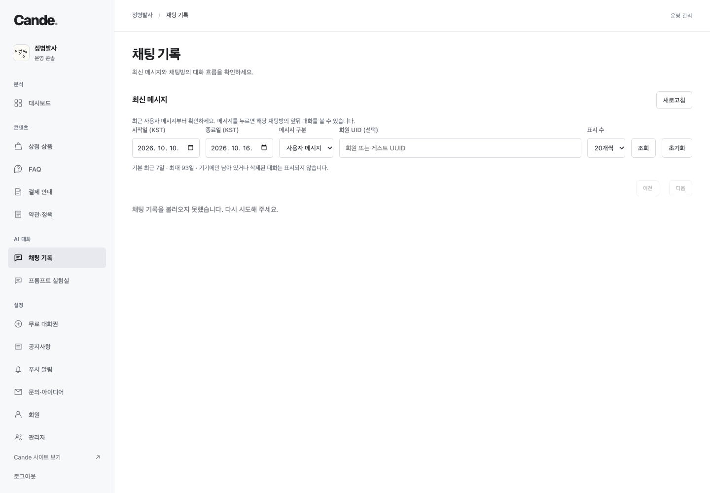
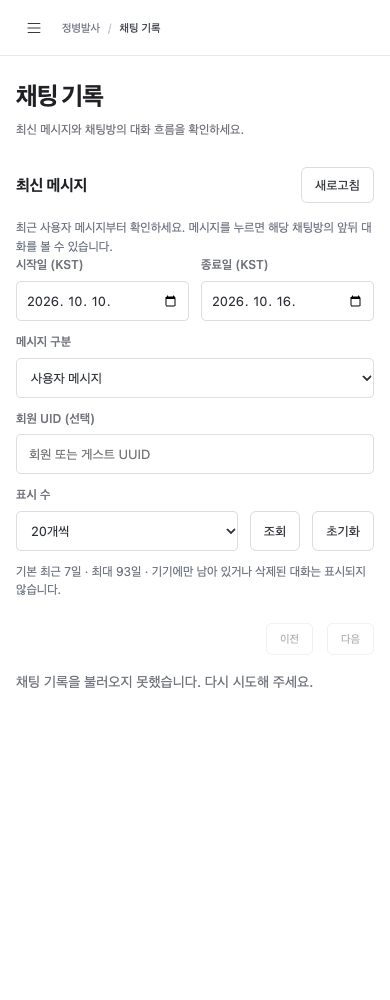

# Admin control alignment — 2026-10-16

## Correction

Chat search UID was 42.14px high, while its dropdowns were 36px and dates 38.14px. Bottom alignment therefore made the UID box and label rise above the rest. Shared row controls now use 40px height, 20px line height and equal vertical padding.

The same rule covers chat filters; product/FAQ/announcement/push/member/support search tools; dashboard filters; administrator add/name forms; member UID/copy; prompt rollback; legal style/selection controls; and push timing/recipient filters. Compact pagination select/button controls use 32px together. Multiline editors, file/range/checkbox inputs and compact table actions keep their existing behavior. On narrow screens collection search fields wrap onto their own row.

## Verification

- Measured 10 menu views and three dialogs at 1440, 1024, 768, 430, 390 and 360px: 78 combinations. Each scoped visible control is exactly 40px (pagination 32px), inside the viewport; no document horizontal overflow. [Measurement summary](measurements.json).
- Before/after screenshots use isolated synthetic fixtures with production CSS, without production user data or API calls. Empty chat API fixture intentionally shows a load error; the controls and layout use the real admin code.
- Existing chat-history, legal and push real Chrome suites passed, including responsive dialogs, history, editing, scheduling and photo controls. These suites use isolated fixtures and all owned browsers are closed in finally.
- CSS-only correction; no backend/app/auth/data changes. Production publication uses official-web main and the verified CANDE/cande6/official-web Vercel project. Final production checks compare the published CSS with this build and measure live chat filter geometry.

