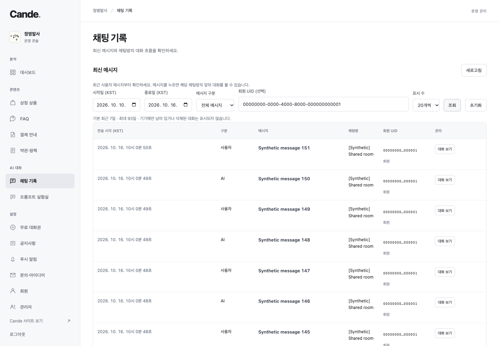
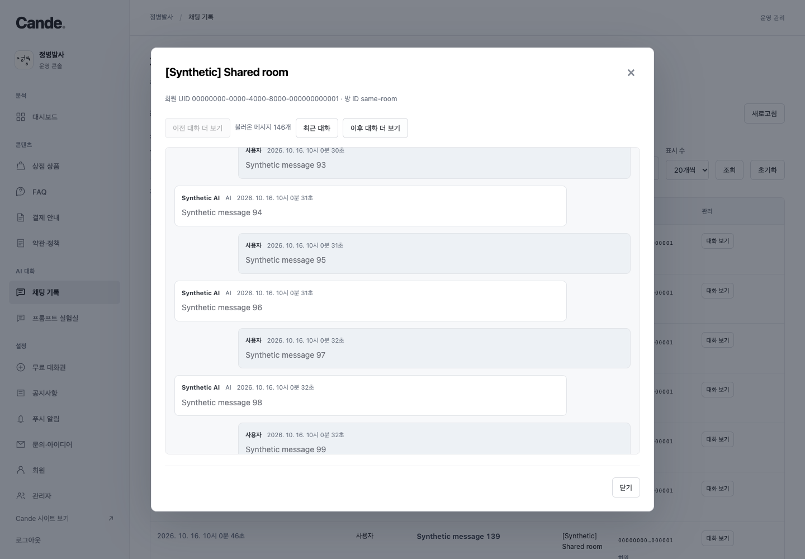
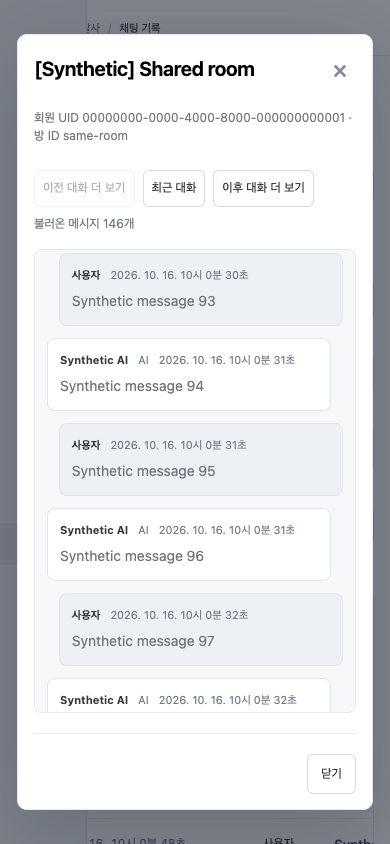

# 채팅 기록 — 2026-10-16

## 화면과 링크

- `/admin/chats`: 최근 사용자 메시지 목록. 기본 최근 7일, KST 날짜(최대 93일), 사용자/AI/안전 안내/실패/전체, 회원·게스트 UID, 20/50개 단위 이전·다음 조회.
- 메시지 클릭 → `/admin/chats/{userUuid}/{roomId}?message={messageId}`. 해당 방의 선택 메시지 전후 최대 50개를 먼저 표시하고 선택 메시지를 강조한다. 이전/이후 대화는 50개씩 추가한다. 최근 대화 버튼·새로고침·브라우저 history·비로그인 링크의 OAuth 복귀를 지원한다.
- 상세는 사용자+방+메시지를 함께 지정한다. 다른 계정의 방/메시지 ID와 겹쳐도 섞이지 않는다. 목록 UID 버튼은 해당 계정 필터를 적용한다. 기기 전용/삭제 데이터는 조회하지 않는다.
- 기존 관리자 테이블/다이얼로그 디자인 재사용. 목록 UID의 긴 줄바꿈을 줄이고 360/390/430px에서 본문 및 다이얼로그가 뷰포트 밖으로 넘치지 않는지 검증했다.

## 서버와 인증

`admin-chat-history` POST `list` / `room`. 기존 verified Google 관리자+enabled allowlist와 service-only RPC 내부 actor 재검증을 거친다. 기존 채팅 RLS/저장/AI/차감 동작은 유지한다. 본문은 plain text이며 HTML을 실행하지 않는다. URL/감사 기록에 대화 원문을 넣지 않는다. 목록은 160자 미리보기이고 전체 원문은 요청한 방의 제한된 페이지에서만 반환한다. 별도 수정·삭제·대신 전송·내보내기 기능은 없다.

서버 코드/마이그레이션/운영 검증: `../mental/docs/admin-chat-history-20261016/README.md`.

## 검증

- `npm run check`, `npm test` (19개), `npm run build`.
- `npm run test:browser`: 기존 여덟 suite와 새 채팅 suite 전부 통과. 새 검증은 기간/UID 필터, 커서 이전/다음, 선택 메시지, 앞뒤 대화 추가, 원문 XSS 차단, 상세 새로고침/OAuth, 360/390/430px, 권한 오류, 오래된 응답과 로그아웃 처리를 포함한다.
- 브라우저는 fixture 클라이언트를 사용하고 운영 채팅/AI/Slack에 연결하지 않는다. 모든 소유 브라우저는 finally에서 종료한다.

### 합성 데이터 화면

